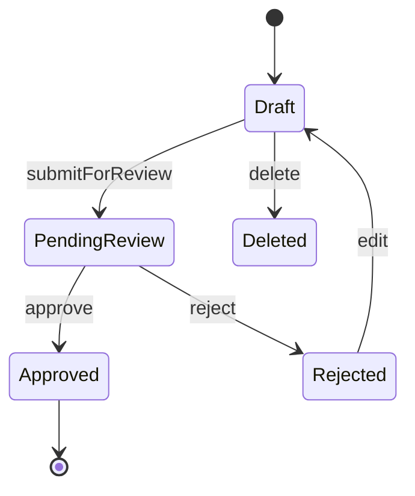
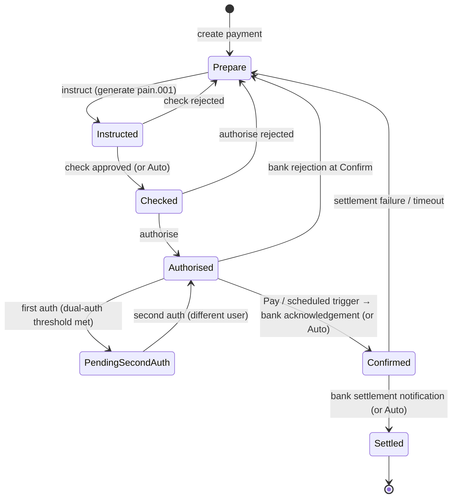

# Design Document: Smart Accounting Software

## Overview

The Smart Accounting Software is a multi-tenant, cloud-based financial management platform targeting small enterprises operating under Chinese Accounting Standards (CAS) or International Financial Reporting Standards (IFRS). It provides a complete accounting lifecycle: from transaction capture (manual vouchers, bank import, invoice scanning) through ledger maintenance, period-end closing, payroll, fixed assets, and tax filing, to financial reporting. Both CAS and IFRS are supported as first-class accounting standards, with standard-specific chart of accounts templates, report formats, and compliance rules applied automatically based on the Account Set's selected standard.

The system is organized around the **Account Set (账套)** as the primary isolation boundary. Each Account Set belongs to one enterprise and contains its own chart of accounts, vouchers, ledger, periods, and settings. A single Finance_User may manage many Account Sets. The system is deployed as **4 independent microservices**: svc-frontend (OWL), svc-accounting (core accounting platform), svc-ml (ML forecast), and svc-nlp (NLP assistant). svc-accounting additionally exposes an optional **MCP Adapter** so External_Agents (Cursor, Claude Desktop, etc.) can invoke a curated subset of read-only accounting tools over the Model Context Protocol.

### Design Goals

- Strict double-entry bookkeeping enforced at the engine level
- Full audit trail for every mutation
- Pluggable external integrations (banks, tax authority, OCR, payment platforms)
- Horizontal scalability per tenant via account-set-scoped data partitioning
- Both CAS (小企业会计准则 / 企业会计准则) and IFRS as first-class accounting standards

---

## Technology Stack

### Frontend — Odoo Web Library (OWL)

- Framework: Odoo Web Library (OWL) — a reactive component framework built on a virtual DOM, used as the official Odoo 16+ frontend framework
- Component model: class-based components with `useState`, `useRef`, `onMounted`, `onWillUnmount` hooks
- Routing: OWL client-side router with hash-based navigation
- State management: OWL reactive stores using `reactive()` and `useState()`
- UI components: Odoo's built-in component library (Form, List, Kanban, Tree, Dialog, Notification, ActionManager)
- RPC layer: `useService("rpc")` and `useService("orm")` for JSON-RPC calls to the Python backend
- Build tooling: Odoo asset bundling pipeline (SCSS + JS/OWL compiled via Odoo's asset bundle system)
- Mobile: Progressive Web App (PWA) manifest + responsive OWL layouts for tablet/mobile access

### Backend — Python

- Language: Python 3.11+
- Web framework: FastAPI for REST/JSON-RPC API layer (high performance, async support, OpenAPI docs auto-generated)
- ORM: SQLAlchemy 2.x (async) with Alembic for schema migrations
- Task queue: Celery with Redis broker for async jobs (bank sync, payslip distribution, OCR, report export)
- Validation: Pydantic v2 for request/response schema validation
- Authentication: python-jose for JWT (RS256) signing/verification
- Encryption: cryptography library (AES-256-GCM for data at rest, secrets stored in HashiCorp Vault via hvac client)
- Testing: pytest + Hypothesis for property-based tests, pytest-asyncio for async tests
- PDF generation: WeasyPrint for financial report PDF export
- Excel export: openpyxl for ledger/report Excel export
- OCR integration: calls external OCR service (e.g., Baidu OCR or Tencent OCR API) via httpx async client
- MCP: official Python SDK (`mcp` / FastMCP) for optional agent tool surface (`backend/smartbook_mcp/`); package name avoids shadowing the `mcp` dependency

### Database — Multi-Database SaaS Mode

- Primary DB: PostgreSQL 15+ (one database per tenant, NOT one schema — full database isolation for SaaS)
- DB routing: Custom SQLAlchemy async engine pool per tenant; tenant→database mapping stored in a central "platform registry" database
- Supported DB backends: PostgreSQL (primary), MySQL 8.0+ (secondary option for cost-sensitive tenants), SQLite (development/testing only)
- DB abstraction: SQLAlchemy dialect-agnostic models so the same ORM models work across PostgreSQL and MySQL
- Connection pooling: asyncpg (PostgreSQL) / aiomysql (MySQL) with per-tenant pool limits
- Migrations: Alembic multi-database migration runner — applies migrations to all tenant databases in parallel
- Tenant provisioning: on new Account Set creation, the platform provisions a new database, runs migrations, and seeds the standard chart of accounts template

### Natural Language Processing — DeepSeek + LangChain

- Model: DeepSeek-R1-Distill (free, open-source distilled reasoning model), self-hosted via **vLLM** (production) or **Ollama** (development); no external API dependency for common interactions
- Orchestration: **LangChain** for tool-calling pipeline — routes user intents to system API functions (query ledger, create voucher, generate report, etc.)
- Intent classification: sentence-transformers (`all-MiniLM-L6-v2`) for embedding-based intent matching; rule-based fallback classifier (spaCy + regex patterns) when model confidence < 0.7
- Conversation context: Redis 7+ stores per-session conversation history (10-turn sliding window); key: `nlp:session:{session_id}`
- Language support: English and Simplified Chinese (zh-CN); language auto-detected per turn
- RBAC enforcement: every tool-call action is validated against the user's RBAC role before execution; NLP layer cannot bypass authorization
- Audit: every NLP interaction (intent, action taken, user_id, account_set_id) is written to `NLPInteractionLog`

### Machine Learning — Python ML Stack

- Core ML library: scikit-learn 1.4+ for classical models (Random Forest, Gradient Boosting, Ridge Regression)
- Time-series forecasting: Prophet (Meta's open-source forecasting library) as the primary model for cash flow time-series with built-in seasonality decomposition (daily, weekly, monthly, yearly)
- Deep learning option: PyTorch + pytorch-forecasting (N-BEATS / TFT models) for tenants with 24+ months of data
- Feature engineering: pandas + numpy for time-series feature extraction (lag features, rolling statistics, calendar features)
- Model serialization: joblib for scikit-learn models, torch.save for PyTorch models; stored in S3-compatible object storage per tenant
- Model registry: MLflow Tracking Server for experiment tracking, model versioning, and metric comparison
- Experiment tracking: MLflow logs training metrics (MAPE, RMSE, MAE), hyperparameters, and model artifacts per Account_Set
- Serving: FastAPI ML inference endpoint (synchronous for ≤12 month horizons); Celery async task for model training
- Data pipeline: pandas DataFrames built from SQLAlchemy queries on BankTransaction and LedgerEntry tables
- Validation: time-series cross-validation using sklearn's TimeSeriesSplit (walk-forward validation)

### Infrastructure

- Container: Docker + Docker Compose for local dev; Kubernetes (K8s) for production
- Cloud: cloud-agnostic design (AWS/GCP/Azure compatible); object storage via boto3 (S3-compatible)
- Message queue: Redis Streams (primary) or RabbitMQ (enterprise option)
- Cache: Redis 7+ for session state, balance cache, NLP conversation context, and rate limiting
- Secrets: HashiCorp Vault for bank credentials, encryption keys, and service-to-service JWT signing keys
- Service mesh: Istio or Linkerd for mTLS between microservices, circuit breaking, and traffic observability
- CI/CD: GitHub Actions — per-service pipelines: lint (ruff, mypy), test (pytest), build Docker image, deploy to K8s; each service has its own image and Helm chart

---

## Architecture

The system is designed as **4 independent microservices**, each with its own deployment lifecycle, scaling policy, and resource profile. Services communicate via the API Gateway (synchronous REST/JSON-RPC) and Redis Streams (async events). All services share a common infrastructure layer (Redis, Vault, PostgreSQL tenant DBs, object storage).

### Microservice Overview

| Service | Technology | Scales On | GPU Required |
|---|---|---|---|
| **svc-frontend** | OWL + Nginx | Request volume / CDN | No |
| **svc-accounting** | FastAPI + Celery | CPU / request rate / queue depth | No |
| **svc-ml** | FastAPI + Celery | Training: GPU nodes; Inference: CPU | Yes (training) |
| **svc-nlp** | FastAPI + vLLM | GPU / concurrent chat sessions | Yes |

### Service Boundaries

**svc-frontend** — OWL Frontend
- Serves the OWL single-page application as static assets via Nginx
- Deployed independently; UI releases never require backend deploys
- Communicates with all backend services exclusively through the API Gateway
- PWA manifest for mobile access

**svc-accounting** — Accounting Core
- All 20 accounting modules: Account Set Manager, Chart of Accounts, Voucher Engine, Ledger Engine, Period-End Processor, Cashier, Payroll, Fixed Assets, Smart Import, Invoice Scanner, Tax Module, Report Engine, Bank Integration, Payment Hub (Domestic, International, Settlement Workflow, Field Config), Reconciliation Engine, IFRS Compliance
- FastAPI REST/JSON-RPC API + Celery workers for async jobs (bank sync, OCR, payslip distribution, report export, payment scheduling)
- Owns all tenant databases (PostgreSQL / MySQL per tenant) and the Platform Registry DB
- Emits voucher-approved events to Redis Streams for internal Ledger Engine consumption
- Optional MCP Adapter (`backend/smartbook_mcp/`): read-only tools over stdio and optional Streamable HTTP at `/mcp` when `SMARTBOOK_MCP_ENABLED=true`

**svc-ml** — ML Forecast Service
- Prophet / N-BEATS model training (Celery async, GPU-scheduled) and inference (FastAPI synchronous, ≤10 s)
- MLflow tracking server + S3 model store
- Reads historical data from tenant DBs via internal REST calls to svc-accounting (never direct DB access)
- Scales training pods on GPU node pools independently from inference pods

**svc-nlp** — NLP Assistant Service
- DeepSeek-R1-Distill served via vLLM (production) or Ollama (development)
- LangChain tool-calling pipeline, sentence-transformers intent classifier, spaCy fallback classifier
- Conversation context stored in Redis (10-turn sliding window per session)
- Calls svc-accounting internal APIs to execute queries and actions on behalf of the user; RBAC enforced before every call
- Scales on GPU nodes independently from svc-ml; vLLM failure triggers automatic fallback to rule-based classifier without affecting svc-accounting

### System Architecture Diagram

```mermaid
graph TD
    subgraph svc-frontend
        WebApp[OWL SPA]
        Nginx[Nginx / CDN]
    end

    subgraph API Gateway
        GW[API Gateway\nJWT Auth · Rate Limit · Routing]
    end

    subgraph svc-accounting
        AccAPI[FastAPI\nAccounting Core]
        AccWorker[Celery Workers\nBank Sync · OCR · Payroll · Reports · Payment Scheduler]

        subgraph Core Accounting
            AS[Account Set Manager]
            COA[Chart of Accounts]
            VE[Voucher Engine]
            LE[Ledger Engine]
            PEP[Period-End Processor]
        end

        subgraph Financial Operations
            CM[Cashier Module]
            PM[Payroll Module]
            AM[Asset Module]
        end

        subgraph Data Ingestion
            SI[Smart Import]
            IS[Invoice Scanner]
        end

        subgraph Compliance
            TM[Tax Module]
            RE[Report Engine]
            IFRS[IFRS Compliance]
        end

        subgraph Banking
            BI[Bank Integration]
            PH[Payment Hub]
            REC[Reconciliation Engine]
        end
    end

    subgraph svc-ml
        MLAPI[FastAPI\nML Inference]
        MLWorker[Celery Workers\nModel Training]
        MLflow[MLflow Tracking]
        ModelStore[Model Store S3]
    end

    subgraph svc-nlp
        NLPAPI[FastAPI\nNLP Assistant]
        vLLM[DeepSeek-R1-Distill\nvLLM Server]
        IntentClassifier[Intent Classifier\nsentence-transformers]
        FallbackClassifier[Fallback Classifier\nspaCy / regex]
        ConvContext[Conversation Context\nRedis]
    end

    subgraph Shared Infrastructure
        RegistryDB[(Platform Registry DB)]
        TenantDBPool[(Tenant DB Pool\nPostgreSQL / MySQL per tenant)]
        Cache[Redis Cache + Streams]
        Vault[HashiCorp Vault]
        Storage[Object Storage S3]
        MQ[Redis Streams / RabbitMQ]
    end

    subgraph Operations Platform
        Prometheus[Prometheus]
        Grafana[Grafana · Loki · Jaeger]
        Alertmanager[Alertmanager]
    end

    subgraph External
        Banks[Bank APIs]
        TaxAuth[Tax Authority API]
        OCR[OCR Service]
        WeChatPay[WeChat Pay / Alipay]
    end

    WebApp --> Nginx --> GW

    GW -->|JSON-RPC / REST| AccAPI
    GW -->|REST| MLAPI
    GW -->|WebSocket / REST| NLPAPI

    AccAPI --> AS & COA & VE & LE & PEP
    AccAPI --> CM & PM & AM
    AccAPI --> SI & IS
    AccAPI --> TM & RE & IFRS
    AccAPI --> BI & PH & REC
    AccAPI --> AccWorker

    VE -->|event| MQ
    MQ -->|consume| LE
    VE --> AuditLog[Audit Log]
    BI --> Banks
    TM --> TaxAuth
    IS --> OCR
    SI --> WeChatPay
    BI --> Cache
    IS --> Storage

    AccAPI --> RegistryDB
    RegistryDB --> TenantDBPool
    AccAPI --> TenantDBPool
    AccWorker --> TenantDBPool
    Vault --> AccAPI

    MLAPI -->|internal REST| AccAPI
    MLWorker -->|internal REST| AccAPI
    MLWorker --> ModelStore
    MLWorker --> MLflow
    MLAPI --> ModelStore

    NLPAPI --> vLLM
    NLPAPI --> IntentClassifier
    NLPAPI --> FallbackClassifier
    NLPAPI --> ConvContext
    NLPAPI -->|internal REST + mTLS| AccAPI
    NLPAPI --> AuditLog

    AccAPI --> Prometheus
    AccWorker --> Prometheus
    MLAPI --> Prometheus
    MLWorker --> Prometheus
    NLPAPI --> Prometheus
    Prometheus --> Grafana
    Prometheus --> Alertmanager
```



### Service-to-Service Communication

| From | To | Protocol | Auth |
|---|---|---|---|
| External_Agent (MCP) | svc-accounting MCP Adapter | stdio or Streamable HTTP (`/mcp`) | JWT via `SMARTBOOK_MCP_TOKEN` |
| svc-frontend | API Gateway | HTTPS JSON-RPC / REST | JWT (user token) |
| API Gateway | svc-accounting | HTTP/2 REST | JWT forwarded |
| API Gateway | svc-ml | HTTP/2 REST | JWT forwarded |
| API Gateway | svc-nlp | WebSocket / HTTP/2 | JWT forwarded |
| svc-nlp | svc-accounting | HTTP/2 REST | mTLS + service JWT |
| svc-ml | svc-accounting | HTTP/2 REST | mTLS + service JWT |

All internal service-to-service calls use mTLS with short-lived service JWTs issued by Vault. Circuit breakers (via `tenacity` / `httpx` retry config) protect svc-accounting from cascading failures in svc-nlp or svc-ml.

### Deployment Model

- **Multi-database SaaS**: one PostgreSQL or MySQL database per tenant, routed via the Platform Registry; full database-level isolation (not schema-level)
- **svc-frontend**: Nginx K8s Deployment + CDN for static asset caching; deploys independently on any UI change
- **svc-accounting**: FastAPI K8s Deployment with HPA (CPU/request rate) + separate Celery worker Deployment scaled by queue depth; owns all tenant DB migrations
- **svc-ml**: FastAPI inference Deployment on CPU nodes (HPA by request rate) + Celery training Deployment on GPU node pool (scaled by training job queue); MLflow and S3 model store shared within service
- **svc-nlp**: FastAPI + vLLM Deployment on GPU nodes (HPA by concurrent sessions); vLLM serves DeepSeek-R1-Distill; Ollama used in development instead of vLLM
- **Shared infrastructure**: Redis (session cache, Streams, NLP context), HashiCorp Vault (secrets), S3-compatible object storage (invoices, reports, ML models), Prometheus/Grafana/Loki/Jaeger (observability)
- **API Gateway**: handles JWT validation, rate limiting, and routing to the correct microservice
- **Service mesh**: Istio or Linkerd recommended for mTLS, circuit breaking, and traffic observability between services

---

## Components and Interfaces

### 1. Account Set Manager

Manages the lifecycle of Account Sets and enforces tenant isolation. The user who creates an Account Set is automatically assigned the Account_Set_Admin role for it.

**Key operations:**
- `createAccountSet(name, journalSetNo, standard: Enum(CAS, IFRS), currency, startPeriod, datasourceType: Enum(Shared, Individual), datasourceConfig?: ExternalDBConfig, status: Enum(Active, Closed)=Active) → AccountSet` — journalSetNo is unique; status defaults to Active; when standard=CAS, seeds from CAS template; when standard=IFRS, seeds from IFRS template; when datasourceType=Individual, validates and provisions schema on the provided external DB connection; auto-assigns Account_Set_Admin role to the creating user
- `switchAccountSet(userId, accountSetId) → SessionContext`
- `listAccountSets(userId) → AccountSet[]` — returns all Account Sets the user has any role in
- `setOpeningBalances(accountSetId, entries[]) → ValidationResult`
- `deleteAccountSet(accountSetId) → void` — Account_Set_Admin only; requires explicit confirmation
- `backupAccountSet(accountSetId) → BackupRef` — Account_Set_Admin only
- `restoreAccountSet(accountSetId, backupRef) → void` — Account_Set_Admin only
- `reinitializeAccountSet(accountSetId) → void` — Account_Set_Admin only; clears all vouchers and ledger data, preserves chart of accounts and settings
- `inviteUser(accountSetId, mobileNumber, role) → Invitation` — Account_Set_Admin only; looks up registered user by mobile, assigns role
- `changeUserRole(accountSetId, userId, newRole) → void` — Account_Set_Admin only; cannot revoke Account_Set_Admin from creator
- `createCustomRole(accountSetId, name, permissions[]) → Role` — Account_Set_Admin only
- `updateCustomRole(accountSetId, roleId, permissions[]) → Role` — Account_Set_Admin only; built-in roles cannot be modified
- `provisionTenantDatabase(accountSetId, datasourceType, config?) → DatabaseConfig` — creates/connects DB, runs Alembic migrations, seeds chart of accounts template
- `getTenantDatabaseConfig(accountSetId) → DatabaseConfig` — looks up the tenant's database connection config from the Platform Registry

**Datasource types:**
- **Shared**: platform provisions a new database in the shared pool (PostgreSQL or MySQL per platform config); default option
- **Individual**: user supplies their own `db_host`, `db_port`, `db_name`, `db_user`, `db_password` for a PostgreSQL 15+ or MySQL 8.0+ instance; platform validates connectivity, then runs Alembic migrations and seeds the chart of accounts on the provided connection; credentials stored in Vault

**Isolation contract:** Every downstream query MUST include `account_set_id`. The API gateway injects this from the JWT claim after the user selects an Account Set. The Platform Registry database stores `(account_set_id → database_url, datasource_type)` mappings; all other modules resolve the tenant DB via this registry before executing queries.

---

### 2. Chart of Accounts (Account Manager)

Maintains the hierarchical account tree (up to 4 levels). Seeded from standard templates on Account Set creation.

**Key operations:**
- `getAccountTree(accountSetId) → AccountNode[]`
- `createAccount(parentCode, code, name, type) → Account`
- `deleteAccount(code) → Result` — rejects if voucher entries exist
- `enableAuxDimension(accountCode, dimension) → Result`
- `validateCode(accountSetId, code) → bool`
- `getStandardTemplate(standard: Enum(CAS, IFRS)) → AccountTemplate`

**Account types:** Asset, Liability, Equity, Revenue, Expense. CAS accounts follow the standard numbering scheme (资产 1xxx, 负债 2xxx, 所有者权益 3xxx, 收入 4xxx-5xxx, 费用 6xxx). IFRS accounts use a flexible numbering scheme per IASB guidance (assets, liabilities, equity, income, expenses) without mandated code ranges.

---

### 3. Voucher Engine

The central double-entry enforcement point. All financial events produce vouchers through this engine.

**Key operations:**
- `createVoucher(type, date, entries[], attachments[]) → Voucher`
- `saveVoucher(voucherId) → ValidationResult` — validates debit = credit
- `submitForReview(voucherId) → Voucher`
- `approveVoucher(voucherId, reviewerId) → Voucher`
- `rejectVoucher(voucherId, reviewerId, reason) → Voucher`
- `deleteVoucher(voucherId, userId) → AuditEntry`
- `batchApprove(voucherIds[]) → BatchResult`
- `batchDelete(voucherIds[]) → BatchResult`

**Voucher lifecycle state machine:**



**Numbering:** Sequential per (account_set_id, period). Gaps are not allowed; deletion records a tombstone.

---

### 4. Ledger Engine

Read-optimized query layer over voucher entries. Maintains materialized running balances updated via event stream from the Voucher Engine.

**Key operations:**
- `getGeneralLedger(accountCode, period) → LedgerEntry[]` — with running balance
- `getSubsidiaryLedger(accountCode, period, dimension?) → DimensionGroup[]`
- `getCashJournal(period) → JournalEntry[]` — account type 1010
- `getBankJournal(period) → JournalEntry[]` — account type 1020
- `getAccountSummary(period) → SummaryRow[]` — opening, debits, credits, closing
- `exportLedger(query, format) → FileRef` — PDF or Excel, ≤15 s

---

### 5. Period-End Processor

Orchestrates month-end close as a multi-step workflow with pre-flight checks.

**Key operations:**
- `carryCostForward(period) → Voucher`
- `carryProfitLoss(period) → Voucher` — uses the CAS-designated retained earnings account for CAS sets; uses the IAS 1 equity retained earnings account for IFRS sets
- `calculateDepreciation(period) → Voucher`
- `closePeriod(period) → CloseResult` — validates all vouchers approved first
- `getNextPeriodOpeningBalances(period) → BalanceEntry[]`
- `getCarryForwardAccount(standard: Enum(CAS, IFRS), type) → AccountCode` — resolves the correct carry-forward target account based on the Account Set's standard

**Close guard:** `closePeriod` queries the Voucher Engine for any voucher in the period with status ≠ Approved. If any exist, it returns an error with the count.

---

### 6. Cashier Module

Thin orchestration layer over the Voucher Engine for cash/bank operations.

**Key operations:**
- `registerAccount(type, code, name, currency) → CashAccount`
- `recordReceipt(from, amount, date, description) → Voucher`
- `recordPayment(to, amount, date, description) → Voucher`
- `recordTransfer(fromAccount, toAccount, amount, fxRate?) → Voucher`
- `reconcilePhysicalCash(accountCode, physicalCount) → DiscrepancyReport`
- `getFxBalance(accountCode) → FxBalance`

---

### 7. Payroll Module

**Key operations:**
- `registerEmployee(name, dept, position, baseSalary) → Employee`
- `recordAdjustment(employeeId, period, amount, type) → Adjustment`
- `accruePayroll(period) → PayrollRun`
- `generatePayslips(period) → Payslip[]` — ≤30 s
- `distributePayslips(period, channel) → DistributionResult`
- `getPayrollVoucher(period) → Voucher`

**Social insurance rates** are configurable per Account Set (五险一金 contribution percentages for employer and employee).

---

### 8. Asset Module

**Key operations:**
- `registerAsset(name, category, acquisitionDate, cost, usefulLifeMonths, method) → Asset`
- `calculateDepreciation(period) → DepreciationResult[]`
- `confirmDepreciation(period) → Voucher`
- `disposeAsset(assetId, disposalDate, proceedsAmount) → Voucher`
- `getAssetRegister() → AssetRegisterRow[]`

**Depreciation methods:** Straight-line (`cost / usefulLifeMonths`) and declining-balance (`netBookValue × rate`).

---

### 9. Smart Import

**Key operations:**
- `importFile(file, format) → ImportSession`
- `parseTransactions(sessionId) → ParsedTransaction[]`
- `suggestAccountMapping(transaction) → AccountSuggestion`
- `confirmMapping(sessionId, mappings[]) → VoucherBatch`
- `getImportSummary(sessionId) → ImportSummary`

**Supported formats:** CSV/XLS exports from major Chinese banks (工行, 建行, 招行, etc.), WeChat Pay bill CSV, Alipay bill CSV.

**Deduplication key:** `(account_set_id, date, amount, reference_number)`

---

### 10. Invoice Scanner

**Key operations:**
- `submitInvoice(image, format) → ScanJob`
- `extractInvoiceData(jobId) → InvoiceData`
- `verifyInvoice(invoiceNumber, amount) → VerificationResult` — calls tax authority API, ≤10 s
- `generateVoucher(jobId, confirmedData) → Voucher`
- `getAttachment(voucherId) → FileRef`

**OCR pipeline:** Image → OCR Service → structured fields → tax authority verification → Finance_User confirmation → Voucher Engine.

---

### 11. Tax Module

**Key operations:**
- `generateFilingReport(period, taxType) → TaxReport`
- `adjustLineItem(reportId, lineId, value) → TaxReport`
- `submitFiling(reportId) → SubmissionResult`
- `getFilingHistory(accountSetId) → FilingRecord[]`

**Tax types:** VAT (增值税), Corporate Income Tax (企业所得税).

---

### 12. Report Engine

Generates standard and custom financial reports from Ledger Engine aggregates (default) or registered external data sources. Report titles, section headings, and line-item terminology follow the Account Set's accounting standard (CAS or IFRS). Supports export, configurable filters, user-defined templates, and pluggable data sources.

**Requirement traceability:** 9.1–9.15

#### Core financial statements (Req 9.1–9.7)

All core reports query materialized ledger balances and period activity for the Account Set. The `standard` parameter defaults to the Account Set's configured standard and MUST NOT allow cross-standard presentation.

| Operation | CAS (Req) | IFRS (Req) |
|-----------|-----------|------------|
| `generateBalanceSheet(filters) → Report` | Balance sheet — CAS terminology and format (9.1) | Statement of Financial Position — IFRS terminology and format (9.2) |
| `generateIncomeStatement(filters) → Report` | Income statement — CAS format (9.3) | Statement of Profit or Loss and Other Comprehensive Income — IFRS format (9.4) |
| `generateCashFlowStatement(filters, method?) → Report` | Cash flow statement — CAS format; `method` ignored (9.5) | Cash flow statement — IAS 7; `method ∈ {Direct, Indirect}` (9.6) |
| `generateAccountSummary(filters, accountCode?) → Report` | Debit and credit totals aggregated by account for the specified period (9.7) | Same |
| `generateDisclosureNotes(filters) → Report` | `StandardMismatchError` | IFRS disclosure notes (accounting policies, significant estimates, standard-specific disclosures); satisfies Req 22.6 when bundled with IFRS statements |

`generateDisclosureNotes` is IFRS-only; calling it on a CAS Account Set returns `StandardMismatchError`.

#### Report parameters (Req 9.11)

Every report operation accepts a `ReportFilter` object:

```
ReportFilter {
  period_code: String nullable          // YYYYMM — used when date range omitted
  date_from: Date nullable              // custom date range start
  date_to: Date nullable                // custom date range end
  report_currency: String nullable      // ISO 4217; defaults to Account Set base currency
  entity_id: UUID nullable              // custom entity (auxiliary dimension / org unit)
  entity_group_id: UUID nullable        // entity group for consolidated views
}
```

- `date_from` / `date_to` override `period_code` when both ends are supplied; the service validates `date_from ≤ date_to`.
- `report_currency` triggers FX conversion using recorded exchange rates when different from the Account Set base currency; display formatting follows the selected currency locale (9.10, 9.11).
- `entity_id` and `entity_group_id` scope ledger queries to the matching auxiliary-dimension values; supplying both is a `ValidationError`.

#### Performance, export, and display (Req 9.8–9.10)

- Report generation MUST complete within **10 seconds** for Account Sets with up to **10,000** ledger transactions in scope (9.8). Exceeding the budget returns `TimeoutError` and logs the slow query.
- `exportReport(reportId, format) → FileRef` — `format ∈ {PDF, CSV}` via WeasyPrint (PDF) and structured CSV writer (9.9).
- Currency amounts are formatted using the Account Set base currency locale (symbol, decimal places, grouping). When `ReportFilter.report_currency` is set, amounts are converted and formatted for that currency (9.10).

#### Report templates (Req 9.12)

Finance_Users create reusable report definitions tied to a data source and publish them to specific user roles.

**Key operations:**
- `createReportTemplate(accountSetId, dataSourceId, layout) → ReportTemplate`
- `updateReportTemplate(templateId, layout) → ReportTemplate`
- `publishReportTemplate(templateId, roleIds[]) → ReportTemplate` — sets status to `Published` and restricts access to the listed Account Set roles
- `listReportTemplates(accountSetId, roleId?) → ReportTemplate[]` — returns templates visible to the caller's role
- `runReportTemplate(templateId, filters) → Report` — executes the template against its data source with the supplied `ReportFilter`

`layout` is a JSON document describing selected fields, grouping, sorting, and column headers. Published templates are read-only for non-admin roles.

#### Data sources (Req 9.13–9.15)

Finance_Users register external data sources that templates and ad-hoc reports can query.

**Key operations:**
- `registerDataSource(accountSetId, config) → ReportDataSource`
- `listDataSources(accountSetId) → ReportDataSource[]`
- `testDataSourceConnection(dataSourceId) → ConnectionTestResult`
- `deleteDataSource(dataSourceId) → void`

**Connection modes (9.14):**

| Mode | Description |
|------|-------------|
| `Ledger` | Default — queries the tenant Ledger Engine (no external connection) |
| `API` | HTTP REST endpoint with configurable auth (API key, Bearer token, or basic auth stored in Vault) |
| `DataServer` | JDBC-style database connection to an external server (9.15) |

**Data Server vendors (9.15):**

| Vendor | Driver | Notes |
|--------|--------|-------|
| `MySQL` | async MySQL connector | Host, port, database, credentials ref |
| `Oracle` | python-oracledb | Service name or SID, credentials ref |
| `SQLServer` | ODBC / aioodbc | Host, database, credentials ref |

Connection strings and credentials are stored as Vault references (`credentials_ref`); they MUST NEVER be persisted in the main database. `testDataSourceConnection` performs a lightweight connectivity check (e.g., `SELECT 1`) and returns success/failure with a diagnostic message.

#### Data model

```
Report {
  id: UUID PK
  account_set_id: UUID FK
  report_type: Enum(BalanceSheet, IncomeStatement, CashFlow, AccountSummary, DisclosureNotes, Custom)
  standard: Enum(CAS, IFRS)
  filters: JSONB                    // serialized ReportFilter
  data: JSONB                       // rendered line items and totals
  generated_at: Timestamp
  generated_by: UUID FK
  generation_ms: Int nullable
}

ReportTemplate {
  id: UUID PK
  account_set_id: UUID FK
  data_source_id: UUID FK → ReportDataSource
  name: String
  layout: JSONB
  status: Enum(Draft, Published)
  published_role_ids: UUID[] nullable
  created_by: UUID FK
  created_at: Timestamp
  updated_at: Timestamp
}

ReportDataSource {
  id: UUID PK
  account_set_id: UUID FK
  name: String
  connection_mode: Enum(Ledger, API, DataServer)
  vendor: Enum(MySQL, Oracle, SQLServer) nullable  // DataServer only
  endpoint_url: String nullable                    // API only
  host: String nullable                            // DataServer only
  port: Int nullable
  database_name: String nullable
  credentials_ref: String nullable                 // Vault key
  config: JSONB                                    // extra driver options
  status: Enum(Active, Failed)
  created_at: Timestamp
}
```

#### API surface

| Method | Path | Description |
|--------|------|-------------|
| GET | `/account-sets/{id}/reports/balance-sheet` | Generate balance sheet / Statement of Financial Position |
| GET | `/account-sets/{id}/reports/income-statement` | Generate income statement / Statement of P&L and OCI |
| GET | `/account-sets/{id}/reports/cash-flow` | Generate cash flow statement (`method` query param for IFRS) |
| GET | `/account-sets/{id}/reports/account-summary` | Generate account summary |
| GET | `/account-sets/{id}/reports/{reportId}/export` | Export report as PDF or CSV |
| POST | `/account-sets/{id}/report-templates` | Create report template |
| POST | `/account-sets/{id}/report-templates/{templateId}/publish` | Publish template to roles |
| POST | `/account-sets/{id}/report-templates/{templateId}/run` | Execute template |
| POST | `/account-sets/{id}/report-data-sources` | Register data source |
| POST | `/account-sets/{id}/report-data-sources/{sourceId}/test` | Test connection |

All report endpoints accept `ReportFilter` as query parameters or request body. Permission: `PERM_REPORTS`.

#### Standard-specific rules

- CAS Account Set: reports use CAS report titles and line-item labels; cash flow uses the CAS indirect presentation; `method=Direct` returns `MethodNotSupportedError`.
- IFRS Account Set: reports use IFRS titles (Statement of Financial Position, Statement of Profit or Loss and Other Comprehensive Income); cash flow supports both IAS 7 direct and indirect methods; direct and indirect presentations MUST report the same net change in cash (Property 5).
- IFRS financial statement bundles MAY include `generateDisclosureNotes` output as an appendix.

---

### 13. Bank Integration

**Key operations:**
- `connectBank(credentials, bankCode) → BankConnection`
- `verifyConnection(connectionId) → ConnectionStatus`
- `syncTransactions(connectionId) → SyncResult` — scheduled daily, also on-demand
- `getBalance(connectionId, date?) → BalanceResult` — ≤5 s, cached 1 hour
- `retryWithBackoff(connectionId) → ConnectionStatus` — up to 3 retries, exponential backoff
- `configureRoutingMethod(connectionId, method: PaymentRoutingMethod, params: RoutingParams) → RoutingConfig` — stores routing configuration (BIC, CNAPS routing number, CIPS participant code, etc.) in the encrypted secrets store
- `getAvailableRoutingMethods(connectionId) → PaymentRoutingMethod[]` — returns only the routing methods supported by the bank and account type for the given connection
- `setDefaultRoutingMethod(connectionId, method: PaymentRoutingMethod) → RoutingConfig`
- `getRoutingConfig(connectionId) → RoutingConfig[]` — returns all configured routing methods for the connection
- `markRoutingMethodUnavailable(connectionId, method, reason) → void` — called when a bank API reports a channel is down; triggers Finance_User notification

**Payment Routing Methods:** `Direct_Debit`, `Online_Banking_Transfer`, `SWIFT`, `CNAPS` (大额支付), `CIPS`, `Local_ACH`, `Internal_Transfer`

**Routing parameter validation:** Each method enforces format rules before saving — SWIFT BIC must be 8 or 11 alphanumeric characters; CNAPS routing number must be 12 digits; CIPS participant code must follow CIPS format. Validation errors are returned as structured `RoutingValidationError` objects.

**Credentials** and routing configuration are stored encrypted (AES-256) in a dedicated secrets store, never in the main DB. All routing configuration changes are written to the Audit Log.

---

### 14. Payment Hub

The Payment Hub is split into four functional areas: Domestic Payment initiation, International Payment initiation, Settlement Process workflow (scheduling queue + stage management), and Payment Field Configuration (admin settings). All share the same underlying payment data model and submission pipeline.

**Settlement Process — 6-stage lifecycle:**



**Stage definitions:**
- **Prepare**: draft payment with all ISO 20022 fields; balance pre-check performed; payment enters scheduling queue
- **Instruct**: ISO 20022 pain.001 message generated and validated against field configuration; UETR generated for SWIFT; payment promoted to Instructed — always Manual
- **Check**: Reviewer inspects instruction details; approves (→ Checked) or rejects with reason (→ Prepare); Auto by default in Standard type
- **Authorise**: Authoriser gives final approval; dual-authorisation enforced when amount exceeds Account_Set threshold; second Authoriser must be a different user — always Manual
- **Confirm**: payment instruction transmitted to bank; bank acknowledges receipt (→ Confirmed) or rejects (→ Prepare with reason); Auto by default in Standard type
- **Settle**: bank sends final settlement notification (funds moved); actual settlement date recorded; if settlement window exceeded, payment flagged for manual review — always Manual

**Payment_Transaction_Type — stage mode configuration:**

Each payment carries a `transaction_type_id` referencing a `PaymentTransactionType` record. Each type defines a `stage_mode` map:

| Stage | Default "Standard" type | Constraint |
|---|---|---|
| Prepare | Auto | configurable |
| Instruct | Manual | always Manual (cannot be Auto) |
| Check | Auto | configurable |
| Authorise | Manual | always Manual (cannot be Auto) |
| Confirm | Auto | configurable |
| Settle | Manual | always Manual (cannot be Auto) |

When a stage is **Auto**, the workflow engine advances the payment immediately after prerequisites are met, recording `triggered_by = system` in `PaymentStageTransition`. When **Manual**, the engine waits for an explicit user action via the appropriate API operation.

**Key operations:**
- `createDomesticPayment(sourceConnectionId, recipientConnectionId, amount, currency, date, reference, transactionTypeId?) → Payment` — creates in Prepare status; auto-advances if Prepare is Auto in the selected type
- `createInternationalPayment(sourceConnectionId, swiftParams: SWIFTPaymentParams, amount, currency, settlementMethod, valueDate, transactionTypeId?) → Payment` — creates in Prepare status
- `instructPayment(paymentId) → Payment` — generates ISO 20022 pain.001 message; validates all Required fields; transitions Prepare → Instructed; auto-advances Check if Check is Auto
- `checkPayment(paymentId, reviewerId, approved: bool, rejectionReason?) → Payment` — Reviewer role; transitions Instructed → Checked or → Prepare; only called when Check is Manual
- `authorisePayment(paymentId, authoriserId) → Payment` — Authoriser role; checks dual-auth threshold; first auth → PendingSecondAuth if threshold met, else → Authorised; second auth by different user → Authorised; auto-advances Confirm if Confirm is Auto
- `confirmPayment(paymentId) → SubmissionResult` — transmits instruction to bank; ≤30 s bank acknowledgement; → Confirmed on success; → Prepare on bank rejection; only called manually when Confirm is Manual or via Pay button
- `payNow(paymentId) → SubmissionResult` — Authoriser role; immediately triggers Confirm stage regardless of scheduled date
- `settlePayment(paymentId, settlementNotification) → Payment` — called by bank webhook or Celery poller; records actual settlement date; → Settled; only called manually when Settle is Manual
- `getSchedulingQueue(accountSetId, filters?) → Payment[]` — returns Prepare + Instructed payments ordered by requested settlement date
- `batchInstruct(paymentIds[]) → BatchResult`
- `batchPay(paymentIds[]) → BatchResult` — batch Pay for all Authorised payments
- `getPaymentStatus(paymentId) → PaymentStatus`
- `getPaymentHistory(paymentId) → StageTransition[]`
- `schedulePayment(paymentId, scheduledDate) → Payment`
- `getTransactionTypes(accountSetId) → PaymentTransactionType[]`
- `saveTransactionType(accountSetId, type: PaymentTransactionType) → SaveResult` — Admin only; validates Instruct/Authorise/Settle always Manual; writes audit log
- `getAvailableRoutingAndSettlement(sourceConnectionId, recipientConnectionId?, paymentScope: Enum(Domestic, International)) → RoutingSettlementOptions`
- `setDefaultSettlementMethod(routingMethod, settlementMethod) → UserPreference`
- `getSettlementCutoffInfo(routingMethod, settlementMethod, date) → CutoffInfo`
- `getFieldConfiguration(accountSetId, routingMethod, settlementMethod) → FieldConfig[]`
- `saveFieldConfiguration(accountSetId, routingMethod, settlementMethod, fieldConfigs[]) → SaveResult` — Admin only
- `getIndicativeExchangeRate(sourceCurrency, targetCurrency) → ExchangeRateResult`

**Role-based stage access:**

| Stage Transition | Required Role | Notes |
|---|---|---|
| Create / Prepare | Accountant, Admin | auto-advances if Prepare=Auto |
| Instruct | Accountant, Admin | always Manual |
| Check (approve/reject) | Reviewer, Admin | skipped if Check=Auto |
| Authorise | Admin, Accountant (with auth permission) | always Manual |
| Confirm (Pay button) | Admin, Accountant (with auth permission) | skipped if Confirm=Auto |
| Confirm (auto/scheduled) | System (Celery task) | when Confirm=Auto or scheduled date reached |
| Settle (manual) | Admin, Accountant (with auth permission) | always Manual |
| Settle (auto) | System (bank webhook / Celery poller) | when Settle notification received |

**Dual-authorisation:** When `payment.amount ≥ account_set.dual_auth_threshold`, `authorisePayment` records the first authoriser and transitions to `PendingSecondAuth`; a second call by a different Authoriser transitions to `Authorised`.

**Scheduling queue:** Celery beat task runs every minute; for each payment in `Authorised` status where `scheduled_date ≤ today` and cut-off has not passed, triggers `confirmPayment` automatically (equivalent to Pay).

**Auto-advance engine:** After every stage transition, the workflow engine checks the payment's `PaymentTransactionType.stage_mode` for the next stage. If the next stage is `Auto`, the engine immediately executes the transition and records `triggered_by = system` in `PaymentStageTransition`. This continues until a Manual stage is reached or the payment is Settled.

**Domestic Payment page — routing → settlement matrix:**

| Payment Routing Method | Currency Scope | Available Settlement Methods |
|---|---|---|
| Direct_Debit | CNY + Foreign | Same_Day_Settlement, Next_Day_Settlement |
| Online_Banking_Transfer | CNY + Foreign | Real_Time_Gross_Settlement (RTGS), Batch_Settlement (T+1) |
| CNAPS | CNY only | Real_Time_Settlement, Scheduled_Settlement |
| CIPS | CNY (cross-border RMB) | Real_Time_Settlement, End_Of_Day_Settlement |
| Local_ACH | CNY + Foreign | Next_Day_Settlement, Two_Day_Settlement |
| Internal_Transfer | CNY + Foreign | Immediate_Settlement |

**International Payment page — routing → settlement matrix:**

| Payment Routing Method | Settlement Methods |
|---|---|
| SWIFT | Standard_Settlement (T+2), Express_Settlement (T+1), Same_Day_Value |

**Dynamic field rendering (ISO 20022 pain.001):** When a Finance_User selects a routing method and settlement method on either payment page, the form calls `getFieldConfiguration` and renders only fields marked Required or Optional for that combination. Required fields are visually marked. Hidden fields are omitted entirely. The default field configuration per combination ships with the system and reflects standard banking practice; Finance_Admins can override per Account_Set via the Payment_Field_Configuration settings page.

**ISO 20022 field set (pain.001 CustomerCreditTransferInitiation):** debtor name, debtor account (IBAN/account number), debtor agent BIC, creditor name, creditor account, creditor agent BIC, creditor agent name, creditor agent address, intermediary agent BIC, payment currency, instructed amount, exchange rate, value date, end-to-end ID, payment purpose code (Cd/Prtry), remittance information (structured/unstructured), charge bearer (SLEV/DEBT/CRED/SHAR), regulatory reporting fields. Minimum always-Required fields (cannot be Hidden): debtor account, creditor name, creditor account, payment currency, instructed amount, value date.

**SWIFT-specific fields:** beneficiary BIC validated as 8 or 11 alphanumeric characters; UETR (Unique End-to-end Transaction Reference) generated on `instructPayment` and stored on the Payment record.

**Cut-off time enforcement:** `getSettlementCutoffInfo` is called for each settlement option before display. If cut-off has passed, the option shows a warning with the next available date.

**Balance pre-check:** Performed at Prepare stage; re-checked at Settle stage before transmission. Rejects if insufficient.

**Payment record:** stores `payment_scope` (Domestic/International), `transaction_type_id` (FK to PaymentTransactionType), `stage` (Prepare/Instructed/Checked/PendingSecondAuth/Authorised/Confirmed/Settled/Rejected), `routing_method`, `settlement_method`, `currency`, `exchange_rate` (nullable), `requested_settlement_date`, `actual_settlement_date`, `uetr` (nullable, SWIFT only), `first_authoriser_id`, `second_authoriser_id` (nullable), and all ISO 20022 fields captured at Instruct time.

---

### 15. Reconciliation Engine

**Key operations:**
- `initiateReconciliation(accountCode, period) → ReconciliationSession`
- `autoMatch(sessionId) → MatchResult[]`
- `manualMatch(sessionId, internalTxId, bankTxId) → MatchResult`
- `getReconciliationReport(sessionId) → ReconciliationReport`
- `getDifference(sessionId) → Decimal`

**Matching algorithm:** Exact match on (date, amount), then fuzzy match on description similarity (Levenshtein distance threshold configurable).

---

### 16. IFRS Compliance Module

Handles IFRS-specific accounting operations that have no direct CAS equivalent. Only active for Account Sets with `accounting_standard = IFRS`. All operations generate vouchers through the Voucher Engine and are subject to the same approval workflow.

**Key operations:**
- `recordFairValueAdjustment(assetId, fairValue, period) → Voucher` — records fair value measurement adjustments per IFRS 9
- `registerRightOfUseAsset(leaseId, cost, term, rate) → Asset` — recognizes a right-of-use asset and corresponding lease liability per IFRS 16; generates the initial recognition voucher
- `recognizeRevenue(contractId, obligationId, amount, period) → Voucher` — records revenue against a specific performance obligation per IFRS 15
- `performImpairmentTest(assetId, recoverableAmount, period) → ImpairmentResult` — compares carrying amount against recoverable amount and generates an impairment loss voucher when carrying amount exceeds recoverable amount, per IAS 36
- `validateIFRSTransaction(voucher) → ValidationResult` — checks that a voucher's entries comply with IFRS recognition and measurement rules; returns a descriptive error referencing the applicable standard if violated

---

### 17. Security and Multi-Tenancy

- **Authentication:** JWT (RS256), 15-minute session inactivity timeout enforced server-side
- **Authorization:** Per-Account_Set RBAC with the following built-in roles:

| Role | Chinese | Key Permissions |
|---|---|---|
| Account_Set_Admin | 账套管理员 | All operations including delete account set, backup/restore, reinitialize, manage user access, link inventory/cloud invoices; auto-assigned to creator |
| Supervisor | 主管 | All accounting ops + create account set; no delete/backup/reinitialize |
| Voucher_Clerk | 制单人 | Vouchers, invoices, payroll, assets, tax, period-end; view cashier/ledger/reports; create account set |
| Cashier | 出纳 | Cashier operations; view vouchers/assets/ledger/reports; create account set |
| Viewer | 查看 | View-only (vouchers, cashier, assets, ledger, reports); create account set |

- **Custom roles:** Account_Set_Admin can create custom roles per Account_Set by selecting a subset of available permissions; custom roles are scoped to that Account_Set only
- **User invitation:** Account_Set_Admin invites other registered users by mobile number and assigns them a role; the invited user gains access to the Account_Set with the assigned role
- **Role enforcement:** Every API request includes `account_set_id` in the JWT claim; the RBAC middleware resolves the user's role for that Account_Set and checks the required permission before executing the handler
- **Tenant isolation:** `account_set_id` in every DB query; enforced via Row-Level Security (RLS) in PostgreSQL; application-layer enforcement for MySQL tenants
- **Encryption at rest:** AES-256 for all financial data columns; bank credentials in a separate secrets vault
- **Encryption in transit:** TLS 1.3 minimum for all external connections
- **Audit log:** Append-only table; every INSERT/UPDATE/DELETE on vouchers, accounts, and settings writes an audit record with `(user_id, action, entity_id, old_value, new_value, timestamp)`; accessible only to Account_Set_Admin role

---

### 18. User Registration and Authentication

Handles new user self-registration (email or mobile), OTP verification, login, and password reset. Lives in **svc-accounting** as part of the auth module, exposed via public (unauthenticated) FastAPI routes.

**Key operations:**
- `registerWithEmail(displayName, email, password) → RegistrationSession` — validates email not already registered, enforces password strength, sends 6-digit OTP to email; OTP valid 10 minutes
- `registerWithMobile(displayName, mobileNumber, password) → RegistrationSession` — validates mobile not already registered, enforces password strength, sends 6-digit OTP via SMS; OTP valid 10 minutes
- `verifyRegistrationOTP(sessionId, otp) → AuthToken` — verifies OTP; on success activates account, issues JWT, returns user to Account Set creation page; on failure increments attempt counter; new OTP request invalidates previous
- `loginWithEmail(email, password) → AuthToken` — validates credentials; enforces account lockout after 10 consecutive failures (15-minute lockout)
- `loginWithMobile(mobileNumber) → OTPSession` — sends fresh 6-digit OTP to registered mobile; OTP valid 10 minutes
- `verifyLoginOTP(sessionId, otp) → AuthToken` — verifies mobile login OTP; issues JWT on success
- `requestPasswordResetEmail(email) → ResetSession` — sends 6-digit OTP to registered email
- `requestPasswordResetMobile(mobileNumber) → ResetSession` — sends 6-digit OTP to registered mobile
- `verifyPasswordResetOTP(sessionId, otp, newPassword) → void` — verifies OTP, enforces password strength, updates password hash
- `resendOTP(sessionId) → void` — rate-limited: max 5 OTP sends per email/mobile per hour; invalidates previous OTP

**User data model:**
```
User {
  id: UUID PK
  display_name: String
  email: String nullable (unique, lowercase-normalised)
  mobile_number: String nullable (unique, E.164 format)
  password_hash: String (bcrypt, cost factor 12)
  status: Enum(PendingVerification, Active, Locked)
  failed_login_attempts: Int (reset on successful login)
  locked_until: Timestamp nullable
  registered_at: Timestamp
  last_login_at: Timestamp nullable
}
```

**OTPRecord data model:**
```
OTPRecord {
  id: UUID PK
  session_id: UUID (registration / login / reset session)
  target: String (email or E.164 mobile)
  otp_hash: String (bcrypt hash of 6-digit code)
  purpose: Enum(Registration, MobileLogin, PasswordReset)
  expires_at: Timestamp (now + 10 minutes)
  used: Bool
  created_at: Timestamp
}
```

**OTP delivery:**
- Email OTP: sent via SMTP (configurable provider, e.g. SendGrid / AWS SES) using an HTML email template
- SMS OTP: sent via SMS gateway (configurable provider, e.g. Aliyun SMS / Twilio) with E.164 number format

**Security controls:**
- Passwords hashed with bcrypt (cost factor 12); never stored in plaintext
- OTP codes hashed before storage; raw code only in transit
- Rate limiting: max 5 OTP sends per target per hour (Redis counter with 1-hour TTL)
- Account lockout: 15-minute lockout after 10 consecutive failed login attempts (Redis key with TTL)
- All registration and login events written to AuditLog

**Public API routes (no JWT required):**
- `POST /auth/register/email`
- `POST /auth/register/mobile`
- `POST /auth/register/verify-otp`
- `POST /auth/login/email`
- `POST /auth/login/mobile`
- `POST /auth/login/verify-otp`
- `POST /auth/password-reset/email`
- `POST /auth/password-reset/mobile`
- `POST /auth/password-reset/verify-otp`
- `POST /auth/otp/resend`

---

### 19. Operations Monitoring Platform

The Operations Monitoring Platform provides full observability of the SaaS system running on the cloud. It is a separate deployment from the application but integrated via standard OpenTelemetry protocols.

**Stack:**
- Metrics: Prometheus (scrapes FastAPI `/metrics` endpoint via `prometheus-fastapi-instrumentator`) + Grafana dashboards
- Logs: Loki (log aggregation) + Promtail (log shipping from K8s pods) + Grafana for log exploration
- Tracing: OpenTelemetry SDK (Python `opentelemetry-sdk`) + Jaeger for distributed trace visualization
- Alerting: Alertmanager (routes alerts to PagerDuty, Slack, email)
- Uptime: Blackbox Exporter for HTTP endpoint probing
- Database monitoring: postgres_exporter / mysqld_exporter per tenant database
- K8s monitoring: kube-state-metrics + node-exporter

**Key dashboards (Grafana):**
- System Overview: total active tenants, API request rate, error rate (5xx), p50/p95/p99 latency
- Tenant Health: per-tenant API call volume, DB query latency, active sessions, failed logins
- Accounting Operations: vouchers created/approved/rejected per period, reconciliation sessions in progress, bank sync success/failure rate
- Background Jobs: Celery task queue depth, task success/failure rate, task duration p95 (bank sync, OCR, payslip distribution)
- Database Fleet: per-tenant DB connection pool utilization, slow query count, replication lag (if read replicas used)
- Security: failed authentication attempts, audit log write rate, vault secret access rate
- ML Forecast: model training job duration, MAPE trend per tenant, forecast request latency p95, retraining trigger rate
- NLP Assistant: intent classification latency p95, DeepSeek-R1-Distill model availability (vLLM health), fallback classifier activation rate, RBAC rejection rate, unknown intent rate, NLP response time p95

**Key alerts:**
- API error rate > 1% for 5 minutes → PagerDuty P2
- API p99 latency > 3 seconds for 5 minutes → PagerDuty P2
- Any tenant DB connection pool exhausted → PagerDuty P1
- Bank sync failure for any tenant > 2 consecutive attempts → Slack notification
- Celery queue depth > 1000 tasks for 10 minutes → Slack notification
- Vault unreachable → PagerDuty P1
- Any K8s pod OOMKilled → Slack notification
- DeepSeek-R1-Distill vLLM service unavailable for > 2 minutes → PagerDuty P2 (fallback classifier activates automatically)
- NLP fallback classifier activation rate > 30% over 10 minutes → Slack notification (indicates DeepSeek-R1-Distill model degradation)
- NLP RBAC rejection rate > 5% over 5 minutes → PagerDuty P2 (possible unauthorized access attempt)

**Key operations:**
- `getSystemHealthSummary() → HealthReport` — aggregates Prometheus metrics into a single health status
- `getTenantMetrics(accountSetId, timeRange) → TenantMetrics` — per-tenant usage and performance metrics
- `getAlertHistory(severity, timeRange) → Alert[]` — historical alert log
- `triggerManualHealthCheck(service) → HealthCheckResult` — on-demand probe of a specific service

**Instrumentation in FastAPI backend:**
- Every API endpoint is instrumented with OpenTelemetry spans: `account_set_id`, `user_id`, `operation`, `duration_ms`, `status_code`
- Every Celery task emits a span with `task_name`, `account_set_id`, `duration_ms`, `status`
- Every DB query emits a span via SQLAlchemy event hooks with `query_hash`, `duration_ms`, `tenant_db`
- Structured JSON logs emitted to stdout (captured by Promtail): `{"timestamp", "level", "service", "account_set_id", "user_id", "trace_id", "message"}`

---

### 20. ML Forecast Engine

Provides per-tenant cash flow forecasting using time-series machine learning models. Each Account_Set has its own isolated Forecast_Model stored in object storage. Training runs as a Celery background task; inference is served synchronously via FastAPI for horizons ≤12 months.

**Model selection strategy:**
- < 6 months data: no model trained; returns `InsufficientDataError`
- 6–23 months data: Prophet model with additive seasonality (monthly + yearly components)
- 24+ months data: Prophet primary; PyTorch N-BEATS as challenger; MLflow model comparison selects winner by lowest MAPE on held-out validation set

**Feature inputs:**
- Monthly aggregated inflow, outflow, net cash flow from BankTransaction table
- Monthly aggregated debit/credit totals from LedgerEntry for cash/bank accounts
- Calendar features: month-of-year, quarter, is_year_end, is_quarter_end
- Lag features: net_cash_flow_lag_1, net_cash_flow_lag_3, net_cash_flow_lag_6
- Rolling statistics: rolling_mean_3m, rolling_std_3m, rolling_mean_6m

**Key operations:**
- `trainModel(accountSetId) → TrainingJob` — Celery async task; fetches historical data, engineers features, trains model, evaluates on validation split, compares with current model in MLflow, promotes if better
- `getForecast(accountSetId, horizonMonths) → ForecastResult` — synchronous; loads current model from S3, generates predictions with confidence intervals; ≤10 s
- `getModelMetrics(accountSetId) → ModelMetrics` — returns current model's MAPE, RMSE, training date, data points used
- `compareForecastVsActual(accountSetId, period) → ComparisonResult` — loads historical forecast snapshots and compares against actual recorded cash flows
- `exportForecast(accountSetId, horizonMonths, format) → FileRef` — PDF or CSV export with predictions, confidence intervals, and model metrics
- `scheduleRetraining(accountSetId) → CeleryTask` — triggered automatically when 30+ new transactions recorded since last training

**Confidence intervals:**
- Prophet: uses built-in uncertainty estimation (Monte Carlo simulation, 1000 samples by default)
- N-BEATS: quantile regression outputs (10th and 90th percentile as lower/upper bounds)

**Model storage layout in S3:**
```
models/
  {account_set_id}/
    current/
      model.pkl (or model.pt)
      metadata.json  (training_date, mape, rmse, data_points, model_type, horizon_months)
    previous/
      model.pkl
      metadata.json
    forecast_snapshots/
      {YYYYMM}.json  (forecast made at period start, for later comparison vs actual)
```

---

### 21. NLP Assistant

Provides a conversational interface to the accounting system in English and Simplified Chinese. Powered by a self-hosted DeepSeek-R1-Distill model served via vLLM, with LangChain orchestrating tool-calling to system APIs. Falls back to a rule-based classifier (spaCy + regex) when model confidence is below threshold.

**Key operations:**
- `classifyIntent(sessionId, userMessage) → IntentResult` — embeds the message via sentence-transformers, matches against known intents; falls back to rule-based classifier if confidence < 0.7
- `executeQuery(sessionId, intent, params) → QueryResponse` — calls the appropriate read-only system API (ledger query, balance lookup, report retrieval) and formats the result as a natural language response
- `executeAction(sessionId, intent, params) → ActionResponse` — calls a write system API (create voucher, submit payment) after RBAC check and explicit user confirmation
- `generateGuidance(sessionId, topic) → GuidanceResponse` — returns step-by-step guidance for accounting tasks (e.g., "how to close a period", "how to record a fixed asset")
- `getConversationContext(sessionId) → ConversationHistory` — retrieves the last 10 turns from Redis
- `clearContext(sessionId) → void` — clears the conversation history for the session

**Intent categories:**
- Query intents: `query_balance`, `query_ledger`, `query_voucher`, `query_report`, `query_forecast`
- Action intents: `create_voucher`, `submit_payment`, `run_reconciliation`, `generate_report`
- Guidance intents: `guide_period_close`, `guide_asset_registration`, `guide_payroll`, `guide_ifrs_recognition`
- Fallback: `unknown` — returns a clarification prompt

**RBAC enforcement:** `executeAction` checks the user's role before calling any write API. A ReadOnly user attempting an action intent receives an `UnauthorizedActionError`. The NLP layer cannot grant permissions beyond what the user's role allows.

**Confirmation flow:** All action intents require a confirmation step — the assistant presents a summary of the action and waits for explicit user confirmation before calling the system API.

---

### 22. MCP Adapter (Partial Agent Tool Surface)

Exposes a curated, **read-only** subset of accounting capabilities to External_Agents via the Model Context Protocol. Complements the NLP Assistant: NLP serves in-product natural language for Finance_Users; MCP serves deterministic tool calls for agent hosts (Cursor, Claude Desktop, automation). Both share the same service layer and RBAC — MCP never bypasses authorization.

**Package layout:**
- `backend/smartbook_mcp/` — FastMCP server, auth helpers, serializers, tool registration (named to avoid clashing with the official `mcp` Python package)
- Entry: `python -m smartbook_mcp` (stdio)
- Optional HTTP: when `SMARTBOOK_MCP_ENABLED=true`, svc-accounting mounts Streamable HTTP at `/mcp` (Tenant DB middleware bypasses `/mcp` paths; auth is enforced inside the adapter)

**Authentication & authorization:**
- JWT supplied via `SMARTBOOK_MCP_TOKEN` (or `MCP_AUTH_TOKEN`)
- Verifies token with the same RS256 path as REST (`auth.jwt.verify_token`)
- Enforces Account_Set RBAC via `auth.rbac.get_role_permissions` before each tool
- Rejects tool calls whose `account_set_id` argument does not match the JWT `account_set_id` claim
- Dev/test defaults skip Redis session inactivity checks unless `SMARTBOOK_MCP_REQUIRE_SESSION=true`

**Tenant DB access outside HTTP requests:**
- `platform.db_router.open_tenant_session(account_set_id)` opens a registry-resolved async session for MCP (and other non-request callers)

**Initial read-only tools:**

| Tool | Permission | Behavior |
|---|---|---|
| `list_account_sets` | authenticated + JWT account set | Lists Account Sets the user can access |
| `get_account_tree` | `ledger` | Returns Chart of Accounts tree |
| `list_vouchers` | `vouchers` | Lists vouchers; optional `period_code` / `status_filter` |
| `get_voucher` | `vouchers` | Returns one voucher with line entries |
| `get_account_summary` | `ledger` | Period opening/debit/credit/closing summary |

**Out of scope (initial partial surface):** create/approve/delete vouchers, payments, bank mutations, backup/restore, NLP chat, ML training.

**Stdlib compatibility:** `backend/platform/__init__.py` re-exports standard-library `platform` APIs so third-party packages (`attrs`, `jsonschema`, `mcp`) keep working despite the backend package name shadowing stdlib `platform`.

**Local agent configuration:** `scripts/cursor-mcp.json.example` documents Cursor MCP server wiring (`cwd` = backend, `PYTHONPATH`, token env).

---

## Multi-Database SaaS Architecture

### Tenant Isolation Model

- Each Account Set gets its own dedicated database (PostgreSQL or MySQL)
- The Platform Registry database (a single shared PostgreSQL instance) stores: `tenant_id`, `account_set_id`, `db_type` (postgres|mysql), `db_host`, `db_port`, `db_name`, `db_user`, `credentials_vault_path`, `provisioned_at`, `status`
- The FastAPI backend resolves the tenant database on every request via a middleware that reads `account_set_id` from the JWT, looks up the Platform Registry (cached in Redis for 5 minutes), and injects the correct async SQLAlchemy engine into the request context

### Database Selection per Tenant

- PostgreSQL: default for all new tenants; supports full feature set including JSONB audit logs, Row-Level Security, and advanced indexing
- MySQL 8.0+: available as a cost-optimized option; all JSONB fields stored as JSON type; RLS enforced at application layer instead of DB layer
- SQLite: development and single-user testing only; not available in production SaaS

### Schema Management

- Alembic migration scripts are dialect-aware (PostgreSQL vs MySQL differences handled via `op.get_bind().dialect.name` checks)
- A `platform-admin` CLI tool (`python -m platform_admin migrate --tenant=all`) runs pending migrations across all tenant databases in parallel (max 10 concurrent)
- New tenant database provisioning takes < 30 seconds end-to-end

### Connection Pool Configuration

- PostgreSQL tenants: asyncpg pool, min_size=2, max_size=10 per tenant
- MySQL tenants: aiomysql pool, min_size=2, max_size=8 per tenant
- Pool overflow requests are queued with a 5-second timeout before returning a `DatabaseUnavailableError`

---

## Data Models

### AccountSet
```
AccountSet {
  id: UUID PK
  owner_user_id: UUID FK  -- the user who created it; always holds Account_Set_Admin
  name: String
  journal_set_no: String UNIQUE  -- Journal Set No.
  accounting_standard: Enum(CAS_SmallEnterprise, CAS_GeneralEnterprise, IFRS)
  base_currency: String (ISO 4217)
  start_period: String (YYYYMM)
  datasource_type: Enum(Shared, Individual)
  status: Enum(Active, Closed)  -- default Active
  created_at: Timestamp
}
```

### AccountSetRole
```
AccountSetRole {
  id: UUID PK
  account_set_id: UUID FK
  name: String  -- e.g. "账套管理员", "主管", "制单人", "出纳", "查看", or custom name
  is_builtin: Bool  -- true = system role, permissions cannot be edited
  permissions: String[]  -- e.g. ["voucher", "cashier", "invoice", "payroll", "asset", "tax",
                         --        "period_end", "ledger", "report", "create_account_set",
                         --        "delete_account_set", "backup_restore", "reinitialize",
                         --        "link_inventory", "link_cloud_invoice", "manage_access"]
  created_at: Timestamp
}
```

### AccountSetMember
```
AccountSetMember {
  id: UUID PK
  account_set_id: UUID FK
  user_id: UUID FK
  role_id: UUID FK (→ AccountSetRole)
  invited_by: UUID FK (user_id of inviter)
  joined_at: Timestamp
  UNIQUE (account_set_id, user_id)
}
```

### Account (Chart of Accounts node)
```
Account {
  id: UUID PK
  account_set_id: UUID FK
  code: String (unique within account_set)
  name: String
  type: Enum(Asset, Liability, Equity, Revenue, Expense)
  parent_code: String nullable
  level: Int (1-4)
  is_leaf: Bool
  aux_dimensions: String[] (department|project|customer|supplier|employee)
  is_system: Bool (system accounts cannot be deleted)
}
```

### Period
```
Period {
  id: UUID PK
  account_set_id: UUID FK
  period_code: String (YYYYMM)
  status: Enum(Open, Closed)
  closed_at: Timestamp nullable
  closed_by: UUID nullable
}
```

### Voucher
```
Voucher {
  id: UUID PK
  account_set_id: UUID FK
  period_code: String
  voucher_number: Int (sequential per account_set + period)
  type: Enum(Receipt, Payment, Transfer)
  date: Date
  description: String
  status: Enum(Draft, PendingReview, Approved, Rejected, Deleted)
  created_by: UUID FK
  reviewed_by: UUID nullable FK
  reviewed_at: Timestamp nullable
  rejection_reason: String nullable
  created_at: Timestamp
}
```

### VoucherEntry
```
VoucherEntry {
  id: UUID PK
  voucher_id: UUID FK
  account_code: String FK
  debit_amount: Decimal(18,2)
  credit_amount: Decimal(18,2)
  description: String
  aux_dimension_type: String nullable
  aux_dimension_value: String nullable
}
```

### VoucherAttachment
```
VoucherAttachment {
  id: UUID PK
  voucher_id: UUID FK
  file_ref: String (object storage key)
  original_filename: String
  uploaded_at: Timestamp
}
```

### LedgerEntry (materialized)
```
LedgerEntry {
  id: UUID PK
  account_set_id: UUID FK
  account_code: String
  period_code: String
  voucher_id: UUID FK
  entry_id: UUID FK
  date: Date
  debit_amount: Decimal(18,2)
  credit_amount: Decimal(18,2)
  running_balance: Decimal(18,2)
  aux_dimension_type: String nullable
  aux_dimension_value: String nullable
}
```

### AccountBalance (period summary)
```
AccountBalance {
  account_set_id: UUID FK
  account_code: String
  period_code: String
  opening_balance: Decimal(18,2)
  total_debits: Decimal(18,2)
  total_credits: Decimal(18,2)
  closing_balance: Decimal(18,2)
  PRIMARY KEY (account_set_id, account_code, period_code)
}
```

### Employee
```
Employee {
  id: UUID PK
  account_set_id: UUID FK
  name: String
  department: String
  position: String
  base_salary: Decimal(18,2)
  status: Enum(Active, Terminated)
}
```

### PayrollRun
```
PayrollRun {
  id: UUID PK
  account_set_id: UUID FK
  period_code: String
  status: Enum(Draft, Confirmed)
  voucher_id: UUID nullable FK
  created_at: Timestamp
}
```

### PayrollLine
```
PayrollLine {
  id: UUID PK
  payroll_run_id: UUID FK
  employee_id: UUID FK
  gross_salary: Decimal(18,2)
  social_insurance_employee: Decimal(18,2)
  housing_fund_employee: Decimal(18,2)
  social_insurance_employer: Decimal(18,2)
  housing_fund_employer: Decimal(18,2)
  net_salary: Decimal(18,2)
}
```

### FixedAsset
```
FixedAsset {
  id: UUID PK
  account_set_id: UUID FK
  name: String
  category: String
  acquisition_date: Date
  original_cost: Decimal(18,2)
  useful_life_months: Int
  depreciation_method: Enum(StraightLine, DecliningBalance)
  accumulated_depreciation: Decimal(18,2)
  net_book_value: Decimal(18,2)
  status: Enum(Active, Disposed)
  disposal_date: Date nullable
}
```

### BankConnection
```
BankConnection {
  id: UUID PK
  account_set_id: UUID FK
  bank_code: String
  account_number_masked: String
  currency: String
  status: Enum(Active, Failed, Disconnected)
  last_synced_at: Timestamp nullable
  credentials_ref: String (vault key, never stored in main DB)
}
```

### BankTransaction
```
BankTransaction {
  id: UUID PK
  connection_id: UUID FK
  account_set_id: UUID FK
  date: Date
  amount: Decimal(18,2)
  direction: Enum(Inflow, Outflow)
  description: String
  reference_number: String
  reconciliation_status: Enum(Unreconciled, Reconciled)
  imported_at: Timestamp
}
```

### Payment
```
Payment {
  id: UUID PK
  account_set_id: UUID FK
  connection_id: UUID FK
  transaction_type_id: UUID FK (→ PaymentTransactionType)
  payment_scope: Enum(Domestic, International)
  stage: Enum(Prepare, Instructed, Checked, PendingSecondAuth, Authorised, Confirmed, Settled, Rejected)
  recipient_name: String
  recipient_account: String
  recipient_agent_bic: String nullable
  intermediary_agent_bic: String nullable
  amount: Decimal(18,2)
  currency: String (ISO 4217)
  exchange_rate: Decimal(18,6) nullable
  charge_bearer: Enum(SLEV, DEBT, CRED, SHAR) nullable
  payment_purpose_code: String nullable
  remittance_info: String nullable
  end_to_end_id: String
  uetr: String nullable (generated at Instruct stage for SWIFT)
  scheduled_date: Date
  routing_method: Enum(Direct_Debit, Online_Banking_Transfer, SWIFT, CNAPS, CIPS, Local_ACH, Internal_Transfer)
  settlement_method: Enum(Same_Day_Settlement, Next_Day_Settlement, Real_Time_Gross_Settlement, Batch_Settlement, Standard_Settlement, Express_Settlement, Same_Day_Value, Real_Time_Settlement, Scheduled_Settlement, End_Of_Day_Settlement, Two_Day_Settlement, Immediate_Settlement)
  requested_settlement_date: Date nullable
  actual_settlement_date: Date nullable
  first_authoriser_id: UUID nullable FK
  second_authoriser_id: UUID nullable FK
  bank_reference: String nullable
  rejection_reason: String nullable
  created_by: UUID FK
  created_at: Timestamp
}
```

### PaymentTransactionType
```
PaymentTransactionType {
  id: UUID PK
  account_set_id: UUID FK
  name: String (e.g., "Standard", "Express", "High-Value")
  is_default: Bool
  is_active: Bool
  prepare_mode: Enum(Manual, Auto)
  instruct_mode: Enum(Manual)  -- always Manual, not configurable
  check_mode: Enum(Manual, Auto)
  authorise_mode: Enum(Manual)  -- always Manual, not configurable
  confirm_mode: Enum(Manual, Auto)
  settle_mode: Enum(Manual)  -- always Manual, not configurable
  created_at: Timestamp
  updated_at: Timestamp
  updated_by: UUID nullable FK
}
```

### PaymentStageTransition
```
PaymentStageTransition {
  id: UUID PK
  payment_id: UUID FK
  account_set_id: UUID FK
  from_stage: Enum(Prepare, Instructed, Checked, PendingSecondAuth, Authorised, Settled, Rejected)
  to_stage: Enum(Prepare, Instructed, Checked, PendingSecondAuth, Authorised, Settled, Rejected)
  triggered_by: UUID FK (user_id; system for auto-scheduled Settle)
  reason: String nullable (rejection reason)
  transitioned_at: Timestamp
}
```

### PaymentFieldConfig
```
PaymentFieldConfig {
  id: UUID PK
  account_set_id: UUID FK
  routing_method: Enum(Direct_Debit, Online_Banking_Transfer, SWIFT, CNAPS, CIPS, Local_ACH, Internal_Transfer)
  settlement_method: Enum(...)  -- same enum as Payment.settlement_method
  field_name: String  -- ISO 20022 pain.001 field identifier (e.g., "creditor_agent_bic", "remittance_info")
  visibility: Enum(Required, Optional, Hidden)
  display_order: Int
  is_system_default: Bool  -- true = shipped default, false = admin override
  updated_at: Timestamp
  updated_by: UUID nullable FK
}
```

### RoutingConfig
```
RoutingConfig {
  id: UUID PK
  connection_id: UUID FK
  account_set_id: UUID FK
  routing_method: Enum(Direct_Debit, Online_Banking_Transfer, SWIFT, CNAPS, CIPS, Local_ACH, Internal_Transfer)
  is_default: Bool
  routing_params_vault_key: String (vault key for method-specific params: BIC, CNAPS number, CIPS code, etc.)
  is_available: Bool
  unavailable_reason: String nullable
  configured_at: Timestamp
  configured_by: UUID FK
}
```

### ReconciliationSession
```
ReconciliationSession {
  id: UUID PK
  account_set_id: UUID FK
  account_code: String
  period_code: String
  status: Enum(InProgress, Complete)
  difference: Decimal(18,2)
  created_at: Timestamp
}
```

### ReconciliationMatch
```
ReconciliationMatch {
  id: UUID PK
  session_id: UUID FK
  internal_entry_id: UUID nullable FK
  bank_transaction_id: UUID nullable FK
  match_type: Enum(Auto, Manual)
  status: Enum(Matched, Unmatched)
}
```

### InvoiceScanJob
```
InvoiceScanJob {
  id: UUID PK
  account_set_id: UUID FK
  file_ref: String
  status: Enum(Pending, Extracted, Verified, VoucherGenerated, Failed)
  invoice_number: String nullable
  invoice_date: Date nullable
  seller_name: String nullable
  buyer_name: String nullable
  amount_excl_tax: Decimal(18,2) nullable
  tax_amount: Decimal(18,2) nullable
  verification_status: Enum(Pending, Verified, Failed) nullable
  verification_reason: String nullable
  voucher_id: UUID nullable FK
}
```

### Report
```
Report {
  id: UUID PK
  account_set_id: UUID FK
  report_type: Enum(BalanceSheet, IncomeStatement, CashFlow, AccountSummary, DisclosureNotes, Custom)
  standard: Enum(CAS, IFRS)
  filters: JSONB
  data: JSONB
  generated_at: Timestamp
  generated_by: UUID FK
  generation_ms: Int nullable
}
```

### ReportTemplate
```
ReportTemplate {
  id: UUID PK
  account_set_id: UUID FK
  data_source_id: UUID FK → ReportDataSource
  name: String
  layout: JSONB
  status: Enum(Draft, Published)
  published_role_ids: UUID[] nullable
  created_by: UUID FK
  created_at: Timestamp
  updated_at: Timestamp
}
```

### ReportDataSource
```
ReportDataSource {
  id: UUID PK
  account_set_id: UUID FK
  name: String
  connection_mode: Enum(Ledger, API, DataServer)
  vendor: Enum(MySQL, Oracle, SQLServer) nullable
  endpoint_url: String nullable
  host: String nullable
  port: Int nullable
  database_name: String nullable
  credentials_ref: String nullable
  config: JSONB
  status: Enum(Active, Failed)
  created_at: Timestamp
}
```

### TaxFiling
```
TaxFiling {
  id: UUID PK
  account_set_id: UUID FK
  period_code: String
  tax_type: Enum(VAT, CorporateIncomeTax)
  status: Enum(Draft, Submitted, Confirmed, Failed)
  confirmation_number: String nullable
  submitted_at: Timestamp nullable
  failure_reason: String nullable
}
```

### AuditLog
```
AuditLog {
  id: UUID PK
  account_set_id: UUID FK
  user_id: UUID FK
  action: Enum(Create, Update, Delete, Approve, Reject, Login, Logout)
  entity_type: String
  entity_id: UUID
  old_value: JSONB nullable
  new_value: JSONB nullable
  timestamp: Timestamp
  ip_address: String
}
```

### IFRSLeaseContract
```
IFRSLeaseContract {
  id: UUID PK
  account_set_id: UUID FK
  asset_id: UUID FK (right-of-use asset in FixedAsset table)
  lease_liability_account_code: String FK
  commencement_date: Date
  lease_term_months: Int
  discount_rate: Decimal(6,4)
  initial_lease_liability: Decimal(18,2)
  remaining_liability: Decimal(18,2)
  status: Enum(Active, Terminated, Expired)
}
```

### IFRSRevenueContract
```
IFRSRevenueContract {
  id: UUID PK
  account_set_id: UUID FK
  customer_name: String
  contract_value: Decimal(18,2)
  currency: String
  start_date: Date
  end_date: Date nullable
  status: Enum(Active, Completed, Cancelled)
}
```

### IFRSPerformanceObligation
```
IFRSPerformanceObligation {
  id: UUID PK
  contract_id: UUID FK
  description: String
  allocated_value: Decimal(18,2)
  recognized_amount: Decimal(18,2)
  status: Enum(Pending, PartiallyRecognized, FullyRecognized)
}
```

### IFRSFairValueAdjustment
```
IFRSFairValueAdjustment {
  id: UUID PK
  account_set_id: UUID FK
  asset_id: UUID nullable FK
  liability_id: UUID nullable FK
  period_code: String
  carrying_amount: Decimal(18,2)
  fair_value: Decimal(18,2)
  adjustment_amount: Decimal(18,2)
  voucher_id: UUID FK
  standard_reference: String (e.g., "IFRS 9")
  created_at: Timestamp
}
```

### ForecastModel
```
ForecastModel {
  id: UUID PK
  account_set_id: UUID FK
  model_type: Enum(Prophet, NBEATS, Ridge)
  model_s3_key: String (path to serialized model in object storage)
  training_date: Timestamp
  data_points_used: Int
  training_periods_start: String (YYYYMM)
  training_periods_end: String (YYYYMM)
  mape: Decimal(6,4) (Mean Absolute Percentage Error)
  rmse: Decimal(18,2)
  mae: Decimal(18,2)
  status: Enum(Active, Superseded, Failed)
  mlflow_run_id: String nullable
  created_at: Timestamp
}
```

### ForecastResult
```
ForecastResult {
  id: UUID PK
  account_set_id: UUID FK
  forecast_model_id: UUID FK
  generated_at: Timestamp
  horizon_months: Int
  export_s3_key: String nullable
}
```

### ForecastPeriod
```
ForecastPeriod {
  id: UUID PK
  forecast_result_id: UUID FK
  period_code: String (YYYYMM)
  predicted_inflow: Decimal(18,2)
  predicted_outflow: Decimal(18,2)
  predicted_net_cash_flow: Decimal(18,2)
  confidence_lower: Decimal(18,2)
  confidence_upper: Decimal(18,2)
}
```

### ForecastSnapshot
```
ForecastSnapshot {
  id: UUID PK
  account_set_id: UUID FK
  snapshot_period: String (YYYYMM — the period when forecast was made)
  target_period: String (YYYYMM — the future period being forecast)
  predicted_net_cash_flow: Decimal(18,2)
  confidence_lower: Decimal(18,2)
  confidence_upper: Decimal(18,2)
  actual_net_cash_flow: Decimal(18,2) nullable (filled in after period closes)
}
```

### ConversationSession
```
ConversationSession {
  id: UUID PK (also used as Redis key prefix)
  account_set_id: UUID FK
  user_id: UUID FK
  language: Enum(en, zh_CN)
  started_at: Timestamp
  last_active_at: Timestamp
  status: Enum(Active, Expired)
}
```

### ConversationTurn
```
ConversationTurn {
  id: UUID PK
  session_id: UUID FK
  turn_index: Int (0-based, within session)
  role: Enum(User, Assistant)
  message: String
  intent: String nullable (classified intent for user turns)
  confidence: Decimal(4,3) nullable (intent classification confidence)
  timestamp: Timestamp
}
```

### NLPInteractionLog
```
NLPInteractionLog {
  id: UUID PK
  account_set_id: UUID FK
  user_id: UUID FK
  session_id: UUID FK
  turn_id: UUID FK
  intent: String
  action_taken: String nullable (system API called, if any)
  rbac_check_passed: Bool
  model_used: Enum(DeepSeek, RuleBasedFallback)
  response_time_ms: Int
  timestamp: Timestamp
}
```

---

## Correctness Properties

*A property is a characteristic or behavior that should hold true across all valid executions of a system — essentially, a formal statement about what the system should do. Properties serve as the bridge between human-readable specifications and machine-verifiable correctness guarantees.*

### Property 1: Account Set creation seeds the correct standard template

*For any* accounting standard (CAS_SmallEnterprise, CAS_GeneralEnterprise, or IFRS), creating an Account Set with that standard should result in a Chart of Accounts whose accounts match the canonical template for that standard — no more, no fewer system accounts.

**Validates: Requirements 11.2, 11.3**

### Property 2: Account codes follow the standard's numbering scheme

*For any* Account Set, every account code in the Chart of Accounts should conform to the numbering scheme of the Account Set's standard: CAS accounts fall within the mandated ranges (assets 1xxx, liabilities 2xxx, equity 3xxx, revenue 4xxx–5xxx, expenses 6xxx); IFRS accounts are unique within the set and follow the flexible IASB scheme with no mandated range constraints.

**Validates: Requirements 12.2, 12.3**

### Property 3: Profit/loss carry-forward targets the correct retained earnings account

*For any* Account Set and any period, executing profit/loss carry-forward should produce a voucher whose credit entry targets the retained earnings account designated by the Account Set's standard: the CAS-designated retained earnings account for CAS sets, and the IAS 1 equity retained earnings account for IFRS sets.

**Validates: Requirements 15.2, 15.3**

### Property 4: Generated reports use the format and terminology of the Account Set's standard

*For any* Account Set and any period, each generated financial statement (balance sheet, income statement, cash flow statement) should use the report title, section headings, and line-item terminology mandated by the Account Set's standard — CAS format for CAS sets, IFRS format (Statement of Financial Position, Statement of Profit or Loss and Other Comprehensive Income, IAS 7 cash flow) for IFRS sets.

**Validates: Requirements 9.1, 9.2, 9.3, 9.4, 9.5, 9.6**

### Property 5: IFRS cash flow statement respects the method parameter

*For any* IFRS Account Set and any period, calling `generateCashFlowStatement` with `method=Direct` and `method=Indirect` should each produce a valid cash flow statement, and the two results should report the same net change in cash despite using different presentation methods.

**Validates: Requirements 9.6**

### Property 6: Fair value adjustment produces a balanced voucher

*For any* IFRS Account Set, asset, fair value amount, and period, calling `recordFairValueAdjustment` should produce a voucher where the sum of debit amounts equals the sum of credit amounts, and the adjustment amount equals `fair_value − carrying_amount`.

**Validates: Requirements 22.1**

### Property 7: IFRS 16 right-of-use asset registration produces correct initial recognition voucher

*For any* IFRS Account Set and lease contract parameters, calling `registerRightOfUseAsset` should produce a voucher that debits the right-of-use asset account by the initial lease liability amount and credits the lease liability account by the same amount, with debit total equal to credit total.

**Validates: Requirements 22.2, 22.3**

### Property 8: IFRS 15 revenue recognition does not exceed allocated obligation value

*For any* IFRS Account Set, revenue contract, and performance obligation, the cumulative `recognized_amount` across all recognition vouchers for that obligation should never exceed the obligation's `allocated_value`.

**Validates: Requirements 22.4**

### Property 9: Impairment loss voucher generated iff carrying amount exceeds recoverable amount

*For any* IFRS Account Set and asset, calling `performImpairmentTest` should generate an impairment loss voucher if and only if the asset's carrying amount is strictly greater than the provided recoverable amount; when carrying amount ≤ recoverable amount, no impairment voucher should be created.

**Validates: Requirements 22.5**

### Property 10: IFRS disclosure notes are present in all IFRS financial statements

*For any* IFRS Account Set and any period, calling `generateDisclosureNotes` should return a report that is non-empty and contains sections covering accounting policies, significant estimates, and at least one standard-specific disclosure.

**Validates: Requirements 22.6**

### Property 11: Invalid IFRS transactions are rejected with a standard reference

*For any* IFRS Account Set, a voucher that violates an enforced IFRS recognition or measurement rule should be rejected by `validateIFRSTransaction`, and the returned `ValidationResult` should contain an error message that references the applicable IFRS standard (e.g., "IFRS 9", "IFRS 15", "IFRS 16", "IAS 36").

**Validates: Requirements 22.7**

### Property 12: Forecast is not generated when insufficient data exists

*For any* Account_Set with fewer than 6 months of historical transaction data, calling `getForecast` should return an `InsufficientDataError` and no `ForecastResult` should be created.

**Validates: Requirement 23.8**

### Property 13: Forecast confidence intervals are well-formed

*For any* Account_Set with sufficient data and any valid Forecast_Horizon, every `ForecastPeriod` in the result should satisfy: `confidence_lower ≤ predicted_net_cash_flow ≤ confidence_upper`.

**Validates: Requirement 23.4**

### Property 14: Model promotion only occurs when new model is at least as accurate

*For any* Account_Set, after a retraining run, the active `ForecastModel` should have a MAPE value less than or equal to the MAPE of the model it replaced; if the new model's MAPE is higher, the previous model remains active.

**Validates: Requirement 23.6**

### Property 15: Forecast horizon bounds are respected

*For any* Account_Set with sufficient data, calling `getForecast` with `horizonMonths=N` should return a `ForecastResult` containing exactly N `ForecastPeriod` records, one for each future period starting from the month after the last closed period.

**Validates: Requirement 23.2, 23.3**

### Property 16: Forecast snapshot actual values are consistent with ledger

*For any* Account_Set and any closed period, the `actual_net_cash_flow` recorded in `ForecastSnapshot` for that period should equal the net cash flow computed from the `AccountBalance` table for the same period (inflow accounts minus outflow accounts).

**Validates: Requirement 23.9**

### Property 17: Intent classification is consistent for semantically equivalent inputs

*For any* user message and its paraphrase (same meaning, different wording), `classifyIntent` should return the same top-level intent category. Tested by generating paraphrase pairs via Hypothesis and asserting intent equality.

**Validates: Requirement 24.3**

### Property 18: NLP layer enforces RBAC — no action executes without authorization

*For any* action intent and any user whose RBAC role does not permit that action, `executeAction` should return `UnauthorizedActionError` and MUST NOT call the underlying system API. The `NLPInteractionLog` entry for the turn should record `rbac_check_passed = false`.

**Validates: Requirement 24.9**

### Property 19: No credential or sensitive data leakage in NLP responses

*For any* conversation turn, the assistant response text should not contain bank credentials, vault keys, JWT tokens, or raw database connection strings. Tested by injecting known credential patterns into conversation context and asserting they do not appear in the response.

**Validates: Requirement 24.10**

### Property 20: Fallback classifier activates when model confidence is below threshold

*For any* user message that produces a DeepSeek intent classification confidence < 0.7, the `classifyIntent` operation should use the rule-based fallback classifier and record `model_used = RuleBasedFallback` in the `NLPInteractionLog`.

**Validates: Requirement 24.12**

### Property 21: Settlement methods presented are always valid for the selected routing method

*For any* source Bank_Account and any Payment_Routing_Method configured for that account, the settlement methods returned by `getAvailableRoutingAndSettlement` should be a non-empty subset of the settlement methods defined in the routing→settlement matrix for that routing method, and should never include a settlement method from a different routing method's set.

**Validates: Requirements 26.2, 26.4**

### Property 22: Routing methods presented are always a subset of those configured and available for the source account

*For any* source Bank_Account, the routing methods returned by `getAvailableRoutingAndSettlement` should be exactly the intersection of: (a) routing methods configured for that account via `configureRoutingMethod`, and (b) routing methods currently marked `is_available = true` for that connection. No routing method that is unconfigured or unavailable should appear.

**Validates: Requirements 25.2, 25.3, 26.3**

### Property 23: ISO 20022 field configuration always includes the mandatory minimum fields as Required

*For any* Account_Set, routing method, and settlement method combination, the `PaymentFieldConfig` records for that combination should always mark the six mandatory fields (debtor account, creditor name, creditor account, payment currency, instructed amount, value date) as `visibility = Required`. No `saveFieldConfiguration` call should be able to set any of these fields to Optional or Hidden.

**Validates: Requirement 28.7**

### Property 24: Payment form fields rendered match exactly the field configuration for the selected routing/settlement combination

*For any* Account_Set, routing method, and settlement method, the set of fields rendered on the payment initiation form should be exactly the union of Required and Optional fields in `PaymentFieldConfig` for that combination — no more, no fewer. Hidden fields must not appear; Required and Optional fields must all appear.

**Validates: Requirements 28.4, 28.5**

### Property 25: Payment stage transitions are strictly sequential and role-enforced

*For any* payment and any stage transition attempt, the transition should only succeed if: (a) the transition follows the defined sequence (Prepare→Instructed→Checked→Authorised→Confirmed→Settled), and (b) the user performing the transition holds the required role for that stage. Any out-of-sequence transition or role violation should return an error and leave the payment stage unchanged.

**Validates: Requirements 29.1, 29.7**

### Property 26: Dual-authorisation is enforced when payment amount meets or exceeds the threshold

*For any* Account_Set with a configured `dual_auth_threshold` and any payment where `amount ≥ dual_auth_threshold`, the payment should not transition from Checked to Authorised with only one authoriser. A second `authorisePayment` call by a different user is required. A single authoriser attempting to provide both approvals should be rejected.

**Validates: Requirement 29.8**

### Property 27: Auto stages advance immediately without user action; Manual stages do not

*For any* payment with a given `PaymentTransactionType`, after each stage completes, if the next stage's mode is Auto then the payment's stage should advance automatically (with `triggered_by = system` in the transition log) without any user API call. If the next stage's mode is Manual, the payment's stage should remain unchanged until an explicit user action is received.

**Validates: Requirements 30.6, 30.7**

---

## Error Handling

### Standard Mismatch Errors

- Any operation that is IFRS-specific (fair value adjustment, right-of-use asset registration, revenue recognition, impairment test, disclosure notes) called on a CAS Account Set MUST return a `StandardMismatchError` with a descriptive message.
- `getStandardTemplate` called with an unrecognized standard value MUST return an `InvalidStandardError`.

### Period-End Errors

- `closePeriod` MUST return a `UnapprovedVouchersError` listing the count of unapproved vouchers if any exist in the period.
- `carryProfitLoss` MUST return a `MissingRetainedEarningsAccountError` if the Account Set's chart of accounts does not contain the expected retained earnings account for its standard.
- `getCarryForwardAccount` MUST return a `ConfigurationError` if the standard/type combination has no configured target account.

### Report Generation Errors

- `generateCashFlowStatement` with `method=Direct` on a CAS Account Set MUST return a `MethodNotSupportedError` (CAS mandates the indirect method by default; the parameter is only meaningful for IFRS).
- `generateDisclosureNotes` called on a CAS Account Set MUST return a `StandardMismatchError`.
- Any report generation that exceeds 10 seconds for ≤10,000 transactions MUST return a `TimeoutError` and log the slow query for investigation.
- `ReportFilter` with `date_from > date_to`, or with both `entity_id` and `entity_group_id` set inconsistently, MUST return a `ValidationError`.
- `registerDataSource` with an unsupported `vendor` for `connection_mode=DataServer` MUST return a `ValidationError` listing supported vendors (MySQL, Oracle, SQLServer).
- `testDataSourceConnection` failure MUST set `ReportDataSource.status = Failed` and return a `ConnectionTestResult` with `success=false` and a diagnostic message; credentials MUST NOT appear in the error payload.
- `runReportTemplate` or `publishReportTemplate` when the caller lacks `PERM_REPORTS` or the template's published role list MUST return `UnauthorizedActionError`.

### IFRS Compliance Errors

- `validateIFRSTransaction` returning a failed `ValidationResult` MUST include `standard_reference` (e.g., "IFRS 9 §5.1.1") so the Finance_User can look up the rule.
- `performImpairmentTest` with a negative `recoverableAmount` MUST return a `ValidationError` before any voucher is created.
- `registerRightOfUseAsset` with `term ≤ 0` or `rate ≤ 0` MUST return a `ValidationError`.

### General Principles

- All errors are returned as structured error objects (not raw exceptions) with `code`, `message`, and optional `details` fields.
- No partial state mutations occur on validation failure — operations are atomic.
- All errors are written to the Audit Log with the originating `user_id`, `entity_type`, and `timestamp`.

### ML Forecast Errors

- `getForecast` called on an Account_Set with < 6 months of data MUST return `InsufficientDataError` with the message including the number of months of data available and the minimum required.
- `getForecast` with `horizonMonths < 1` or `horizonMonths > 12` MUST return `ValidationError`.
- `trainModel` that fails due to a data quality issue (e.g., all-zero cash flows, missing periods) MUST set the `ForecastModel.status = Failed` and log the failure reason; it MUST NOT overwrite the current active model.
- `getForecast` when no active model exists (first-time or all models failed) MUST return `ModelNotReadyError` with a message indicating training is in progress or has not yet been triggered.
- Any forecast generation exceeding 10 seconds MUST return `TimeoutError` and log the slow inference for investigation.

### NLP Errors

- `classifyIntent` when the DeepSeek-R1-Distill model is unavailable MUST fall back to the rule-based classifier and record `model_used = RuleBasedFallback`; it MUST NOT return an error to the user.
- `executeAction` for any user with insufficient RBAC permissions MUST return `UnauthorizedActionError` with a message describing the required role; the underlying system API MUST NOT be called.
- `classifyIntent` returning `intent = unknown` MUST respond with a clarification prompt asking the user to rephrase; it MUST NOT attempt to execute any system action.
- Any NLP response generation exceeding 5 seconds MUST return a partial response with a `slow_response` flag and log the latency for investigation.
- `executeAction` MUST require explicit user confirmation before calling any write API; if confirmation is not received within the same turn, the action is cancelled and logged.

---

## Testing Strategy

### Dual Testing Approach

Both unit tests and property-based tests are required. They are complementary:
- Unit tests cover specific examples, integration points, and error conditions.
- Property-based tests verify universal correctness across randomized inputs.

### Unit Tests

Focus areas:
- Specific examples of CAS vs IFRS report output (verify exact section headings and line-item labels)
- Integration between IFRS Compliance Module and Voucher Engine (voucher creation, approval workflow)
- Error condition examples: standard mismatch, period not closed, impairment with negative recoverable amount
- Edge cases: zero fair value adjustment, lease with minimum term, performance obligation fully recognized
- ML model training pipeline: verify feature engineering produces correct lag and rolling features from known input data
- Prophet model integration: verify forecast output structure (period codes, confidence interval ordering)
- Model promotion logic: verify that a challenger model with higher MAPE does not replace the current model
- Insufficient data edge case: exactly 5 months of data returns error; exactly 6 months succeeds
- MCP Adapter: JWT/token resolution, account_set_id mismatch rejection, RBAC denial, tool registration surface, and service-wrapper happy path for list vouchers (`backend/tests/test_smartbook_mcp_unit.py`)

### Property-Based Testing

**Library selection:** **Hypothesis** (Python) is the mandatory property-based testing library for this project. Do not implement property-based testing from scratch.

**Async testing:** pytest-asyncio is required for testing async FastAPI endpoints and SQLAlchemy async sessions.

**Generators:** `hypothesis.strategies` should be used to generate valid `AccountSet`, `Voucher`, and `VoucherEntry` objects for property tests.

**Configuration:** Each property test MUST run a minimum of 100 iterations.

**Tagging convention:** Each property test MUST include a comment in the format:
`# Feature: smart-accounting-software, Property {N}: {property_text}`

**Property test mapping:**

| Design Property | Test Description |
|---|---|
| Property 1 | For any standard, account set creation seeds the correct template |
| Property 2 | For any account set, all account codes conform to the standard's numbering scheme |
| Property 3 | For any account set and period, carry-forward targets the correct retained earnings account |
| Property 4 | For any account set and period, report titles and headings match the standard |
| Property 5 | For any IFRS account set, direct and indirect cash flow methods yield the same net cash change |
| Property 6 | For any fair value adjustment, the resulting voucher is balanced and adjustment = fair_value − carrying_amount |
| Property 7 | For any IFRS 16 lease registration, the initial recognition voucher debits ROU asset and credits lease liability by equal amounts |
| Property 8 | For any IFRS 15 obligation, cumulative recognized amount never exceeds allocated value |
| Property 9 | Impairment voucher is generated iff carrying amount > recoverable amount |
| Property 10 | Disclosure notes report is non-empty and contains required sections for any IFRS account set |
| Property 11 | Invalid IFRS transactions are rejected with a standard reference in the error message |
| Property 12 | getForecast returns InsufficientDataError for any account set with < 6 months data |
| Property 13 | For any forecast result, all confidence intervals satisfy lower ≤ predicted ≤ upper |
| Property 14 | After retraining, active model MAPE ≤ replaced model MAPE |
| Property 15 | getForecast with horizonMonths=N returns exactly N ForecastPeriod records |
| Property 16 | ForecastSnapshot actual values match AccountBalance net cash flow for closed periods |
| Property 17 | For any semantically equivalent message pair, classifyIntent returns the same intent category |
| Property 18 | executeAction with unauthorized user role returns UnauthorizedActionError and does not call the system API |
| Property 19 | NLP responses never contain credential or sensitive data patterns |
| Property 20 | classifyIntent uses rule-based fallback when DeepSeek confidence < 0.7 |
| Property 21 | Settlement methods returned are always a valid subset of the routing→settlement matrix for the selected routing method |
| Property 22 | Routing methods returned are always the intersection of configured and currently available methods for the source account |
| Property 23 | ISO 20022 field configuration always marks the six mandatory fields as Required for any routing/settlement combination |
| Property 24 | Payment form fields rendered match exactly the Required + Optional fields in the field configuration for the selected combination |
| Property 25 | Payment stage transitions are strictly sequential and role-enforced |
| Property 26 | Dual-authorisation is enforced when payment amount meets or exceeds the Account_Set threshold |
| Property 27 | Auto stages advance immediately with system trigger; Manual stages wait for explicit user action |

Each correctness property MUST be implemented by a single property-based test. Unit tests handle the specific examples and error conditions listed above.
